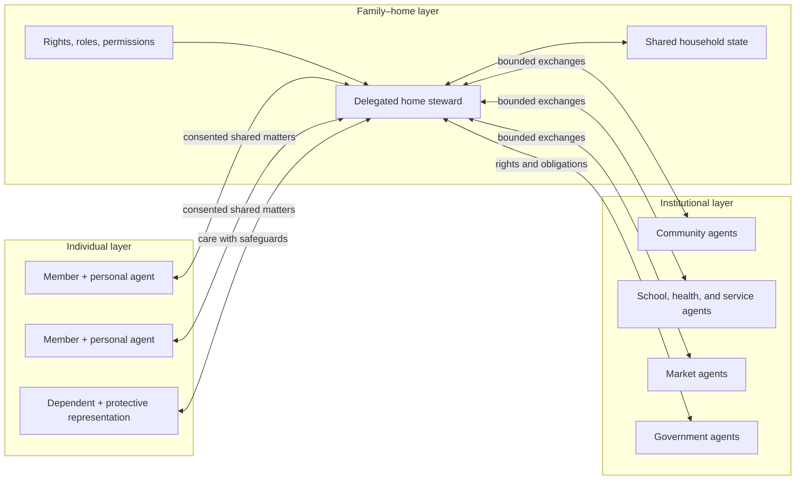

# Homie

Homie is an exploration of what it means for a family–home to become an agent in a wider society of agents.

The project begins with a domain model rather than an application. Its working proposition is:

> A family–home is a persistent, adaptive system that sustains and develops its members while preserving a viable, meaningful collective across time.

The family and the home are coupled but distinct. The family is relational; the home is its habitat and operational commons. Safety, dignity, privacy, and basic autonomy form a rights floor that neither the household nor its agent may trade away.

## Current checkpoint

This repository currently contains:

- [The foundational model](docs/foundational-model.md): components, functions, boundaries, governance, and agent topology.
- [The first experiment](experiments/ordinary-weekday.md): a traced ordinary weekday in a fictional mixed household.
- [The companion interface concept](docs/interface-concept.md): Homie's proposed Hearth, Whisper, Home, Signal, and Door interaction forms.
- [Existing agent infrastructure assessment](docs/existing-agent-infrastructure.md): what Homie can reuse from OpenClaw and Hermes, and which household-governance capabilities remain unique.
- [Machine-readable experiment data](experiments/ordinary-weekday.json) and its [JSON Schema](schemas/family-home.schema.json).
- [A dependency-free validator](scripts/validate_model.py) and regression tests.
- [The current handoff](HANDOFF.md), [foundation-session transcript](docs/sessions/2026-07-16-foundation.md), and [agent-infrastructure session](docs/sessions/2026-07-18-agent-infrastructure.md) for continuing the exploration on another device.



## Validate the model

Python 3 is the only requirement.

```powershell
python scripts/validate_model.py
python -m unittest discover -s tests -v
```

The validator checks structural requirements, enumeration values, references between records, the rights floor, and experiment coverage. It deliberately stays small while the ontology is still changing.

## Working method

Each experiment should:

1. Put the model into a concrete household situation.
2. Record needs, rights, information boundaries, authority, agent action, escalation, and outcomes.
3. Look for facts the current ontology cannot represent cleanly.
4. Turn those gaps into explicit revisions or new experiments.

The fictional household is an experimental instrument, not a universal definition of family.
