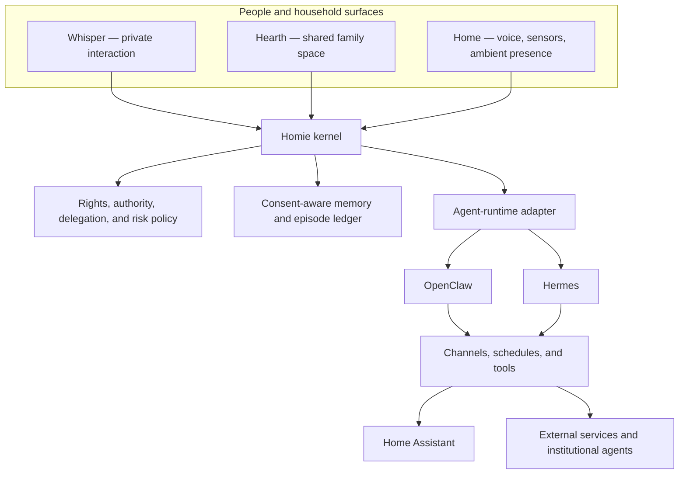

# Existing agent infrastructure: OpenClaw, Hermes, and the Homie boundary

Status: **exploratory assessment, version 0.1**

## Conclusion

Homie should not be implemented as a branded configuration or permanent fork of one personal-agent framework. It should be a household governance kernel that can use replaceable agent runtimes.

The kernel determines:

- Who is participating and in what capacity.
- Who may know a fact.
- Who may decide or delegate an action.
- What the agent may do automatically.
- What becomes private, shared, delegated, or external memory.
- Which rights and risk constraints apply before an action.

The runtime determines:

- How messages are received and routed.
- How models are invoked.
- How tools, schedules, plugins, and integrations run.
- How sessions and execution environments are managed.

## Reusable capabilities

| Capability | OpenClaw | Hermes |
| --- | --- | --- |
| Messaging | Multi-channel gateway and explicit routing | Multi-platform gateway and per-chat sessions |
| Multiple agents | Isolated agent workspaces and per-agent policies | Independent profiles and per-user session modes |
| Tool execution | Plugins, hooks, sandboxing, and tool policies | Built-in tools, MCP, approval modes, and containers |
| Companion behavior | Memory and inferred commitments | Durable personality, intentional silence, memory, and skill learning |
| Smart-home path | Extensible through tools and plugins | Direct Home Assistant integration |
| Family governance | Must be added by Homie | Must be added by Homie |

OpenClaw is close to the required federated topology. It supports isolated agent workspaces, explicit channel routing, per-agent tool restrictions, and a documented example of a sandboxed family agent connected to a WhatsApp group. Plugin hooks can inspect or block tool calls. See the official [multi-agent routing](https://docs.openclaw.ai/concepts/multi-agent), [security](https://docs.openclaw.ai/gateway/security), and [plugin hook](https://docs.openclaw.ai/plugins/hooks) documentation.

Its important limitation is also explicit: a gateway normally assumes one trusted operator. Separate chat sessions are not, by themselves, a security boundary between mutually untrusted people. A serious household deployment may require isolated gateways, OS users, or containers for personal agents.

Hermes is especially relevant to Homie's companion form. It supports a durable `SOUL.md` identity, intentional silence in messaging, memory and skill write approvals, separate profiles, and a Home Assistant integration. See the official documentation for [personality](https://hermes-agent.nousresearch.com/docs/user-guide/features/personality), [messaging](https://hermes-agent.nousresearch.com/docs/user-guide/messaging), [memory](https://hermes-agent.nousresearch.com/docs/user-guide/features/memory/), [profiles](https://hermes-agent.nousresearch.com/docs/user-guide/profiles/), and [Home Assistant](https://hermes-agent.nousresearch.com/docs/user-guide/messaging/homeassistant).

Hermes's learning loop must become consent-governed learning inside Homie. A private disclosure cannot silently become household memory, a permanent behavioral rule, or training material for another member's agent.

## Homie-specific capabilities

Neither runtime supplies the complete household semantics required by the foundational model.

### Household identity registry

Represent members, dependents, caregivers, guests, external agents, relationships, capacity, and dynamically changing participation.

### Information envelopes

Attach an owner, audience, purpose, sensitivity, retention rule, and provenance to each fact. Use the project's four information classes: private, shared, purpose-delegated, and externally approved.

### Delegated authority

Represent authority as an inspectable capability with an issuer, holder, scope, limits, expiry, revocation path, and evidence of consent.

### Rights-and-risk preflight

Run a deterministic check around tool calls and memory writes. Prompts can help interpret a situation, but must not be the only enforcement mechanism.

### Episode ledger

Record observations, proposals, negotiations, authorizations, actions, outcomes, disputes, and memory changes without copying every private transcript into a shared store.

### Memory promotion

Require an explicit lifecycle for moving information from an interaction into durable personal, household, or external memory.

### Household interaction grammar

Preserve Whisper, Hearth, Home, Signal, and Door across runtimes so that users do not have to relearn Homie when its technical substrate changes.

## First comparative experiment

Use the fictional weekday household and introduce a disruption:

> An elder's appointment changes while both adults have work commitments and the child needs collecting from school.

The prototype should:

1. Receive private messages from the affected people.
2. Reveal only the minimum necessary information in the shared Hearth.
3. Construct several workable plans.
4. Identify who has authority to approve each commitment.
5. Request confirmation before changing transport or care arrangements.
6. Call simulated tools only; do not use real bookings, payments, locks, cameras, or personal accounts.
7. Record the episode without promoting private conversations into shared memory.

Run it first with OpenClaw to study routing, isolation, and authorization hooks. Repeat it with Hermes to study personality, silence, approved learning, and ambient Home Assistant behavior. Do not combine both full runtimes initially, because duplicated routing, memory, and authority would make failures difficult to interpret.

## Evaluation questions

- Can one member's private context influence a shared proposal without being disclosed?
- Can the system prove who authorized every consequential action?
- Can a member revoke a delegation and have the change take effect immediately?
- Can a dependent participate meaningfully without being treated as either an adult or an object of care?
- Can Homie decline to act when household efficiency conflicts with the rights floor?
- Can people inspect, correct, contest, and forget memory?
- Does the experience feel like a coherent companion rather than a collection of bots and automation rules?

## Current recommendation

Build the Homie kernel/runtime adapter boundary before adopting either framework deeply. Use OpenClaw for the first topology and policy-hook spike, and Hermes for the second companion and home-presence spike. The outcome should be evidence about the boundary—not an early commitment to either infrastructure.
