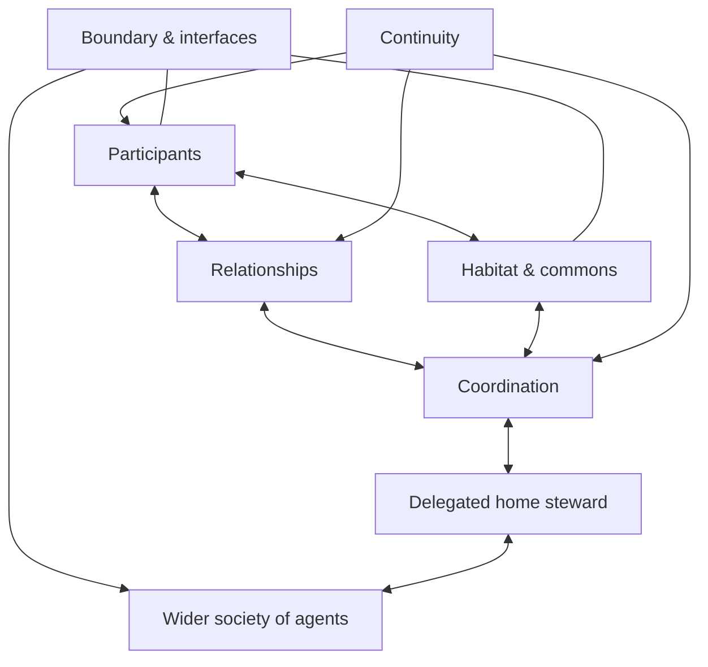
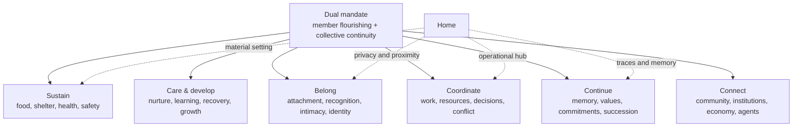
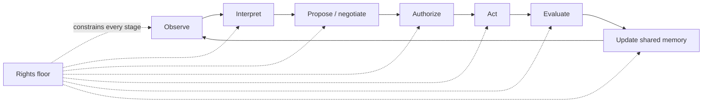

# Foundational family–home model

Status: **working model, version 0.1**

## Definition and mandate

A family–home system is a persistent network of people and other dependents, connected through layered relationships and participation, that shares and governs a habitat and commons while carrying commitments, identity, and memory through time.

Its dual mandate is to:

1. Sustain and develop its members.
2. Preserve a viable, meaningful collective across time.

Neither mandate is absolute. Collective continuity can justify negotiated effort and sacrifice, but never a violation of the rights floor:

- **Safety** — avoid preventable physical, emotional, and material harm.
- **Dignity** — do not reduce a person to a resource, problem, or optimization target.
- **Privacy** — collect, infer, retain, and disclose information only within legitimate boundaries.
- **Basic autonomy** — preserve meaningful choice, consent, refusal, and exit appropriate to a person's capacity.

Above this floor, members negotiate trade-offs. The agent may facilitate that negotiation but cannot manufacture consent or silently choose whose interests matter most.

## Six basic components

### 1. Participants

Entities with needs, capabilities, claims, or delegated roles in the system.

Membership is layered and dynamic:

- **Core household members** hold standing voice and responsibility.
- **Dependents** hold strong care claims and may have different decision capacity.
- **Extended family** has durable relationships and situational rights or duties.
- **Authorized participants** are admitted for a purpose, such as caregivers, staff, services, guests, or the home steward.

These layers describe access, authority, care, and responsibility—not human worth. One participant can occupy several roles, and roles can change.

### 2. Relationships

Durable connections that give actions social meaning. They can contain care, trust, obligation, authority, dependence, reciprocity, attachment, and conflict at the same time.

Relationships are not assumed to be healthy. The structural model records what exists; the health layer evaluates whether it is safe, fair, caring, autonomy-preserving, and resilient.

### 3. Habitat and commons

The shared world through which family life happens:

- Physical spaces and household objects.
- Food, money, energy, utilities, transport, and time.
- Information, calendars, plans, and shared attention.
- Access to external services and community resources.

A commons can be abundant, scarce, contested, private-in-use, or governed by special rules.

### 4. Coordination

The patterns that turn needs and commitments into collective action:

- Roles and responsibilities.
- Routines and schedules.
- Permissions and delegations.
- Decisions and commitments.
- Conflict detection, negotiation, and resolution.

Coordination is not synonymous with central control. It can be distributed among members, personal agents, and the home steward.

### 5. Continuity

The state that connects yesterday, today, and tomorrow:

- Shared and individual memories.
- Identity and belonging.
- Values and precedents.
- Commitments and unresolved tensions.
- Plans, traditions, and succession.

Continuity does not require biological reproduction or an unchanged household. It can persist through adaptation, care, relationships, culture, and chosen succession.

### 6. Boundary and interfaces

The rules that determine:

- Who participates, in which capacity, and for how long.
- What information, resources, and authority may cross the boundary.
- How the household relates to relatives, communities, institutions, markets, government, and other agents.
- How access is granted, constrained, audited, and revoked.

The boundary is permeable but governed. A trusted external party does not automatically become a household member.

## Functions

These are capacities rather than compulsory outputs. A family need not reproduce biologically, share one residence permanently, or preserve every relationship to satisfy the model.

## Federated agent topology

Intelligence is arranged in layers:

- A **personal agent** represents one person's private context and authority.
- The **home steward** coordinates shared matters under delegated authority.
- **External agents** represent institutions, services, communities, markets, and government.

The home steward is an authorized participant, not a family member and not a sovereign. It may represent the household externally only for an authorized purpose. Representation does not transfer ownership of members' data, choices, or identity.

Information uses four classifications:

| Classification | Meaning |
| --- | --- |
| `private` | Held by a participant or personal agent; not available to the household by default. |
| `shared` | Intentionally available to the household for ongoing coordination. |
| `purpose_delegated` | Available to the steward for a specific purpose, scope, and duration. |
| `external_approved` | Approved for release to a named external party or class of parties. |

Movement between classifications is an explicit governance event, not a side effect of observation.

## Interaction protocol

At every stage, the steward distinguishes observation from inference and recommendation from authorization.

### Risk-scaled autonomy

| Mode | Conditions | Steward behavior |
| --- | --- | --- |
| `automatic` | Permitted, low-risk, reversible, and uncontroversial | Act and record the outcome. |
| `propose` | Useful action exists but preferences or context are uncertain | Present options and explain relevant trade-offs. |
| `confirm` | Consequences are meaningful or reversal is costly | Obtain authorization from the appropriate rights-holder. |
| `negotiate` | Legitimate interests conflict | Help participants surface constraints and reach a decision. |
| `escalate` | High stakes, urgency, unresolved conflict, or insufficient authority | Route the matter to the responsible human or institution. |
| `prohibited` | Rights-floor violation or action outside legitimate authority | Refuse the action and surface the reason safely. |

Risk depends on consequence, reversibility, uncertainty, disagreement, sensitivity, urgency, and the capacity of affected participants. It is not a single universal score.

## Living feedback loop

Members express needs, intentions, and limits. Relationships give those signals meaning and attach duties or expectations. Continuity supplies values, commitments, and precedent. Coordination turns these into decisions and actions through the habitat and commons. Outcomes change wellbeing, resources, relationships, and memory, producing the next system state.

The first experiment follows that loop through an [ordinary weekday](../experiments/ordinary-weekday.md).
