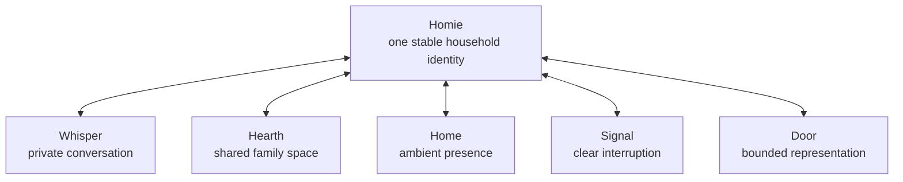

# Interface concept: Homie as a household presence

Status: **exploratory concept, version 0.1**

## Product proposition

ChatGPT was offered as a conversation with an intelligence. Homie should be offered as a relationship with a household presence.

Its form should not be reduced to one device, screen, robot, or chat window. Homie is one recognizable character expressed through several interaction surfaces according to audience, context, urgency, and authority.

## The central form: the Hearth

Homie's iconic interface should be a persistent shared household space called the **Hearth**.

Unlike a normal chat, it opens onto the household's present life:

- What is happening now?
- What needs attention?
- Who is affected?
- Is Homie observing, suggesting, waiting for permission, or acting?
- What will become shared memory?

Conversation remains the universal input, but messages belong to household episodes—school transport, dinner, elder care, repairs, celebrations, and plans—rather than an undifferentiated chat history.

The household episode is therefore the primary interaction object. It connects conversation to participants, information boundaries, decision rights, actions, outcomes, and memory.

## One identity, five manifestations

### Whisper

Each person has a private relationship with Homie through text, voice, or another personal channel. Private conversation does not become household memory unless the person deliberately shares something.

### Hearth

The shared family space supports collective decisions, rituals, stories, plans, and active household episodes. The audience is always visible, and Homie records only information legitimately accepted as shared.

### Home

Homie can be quietly present through environmental cues and reversible actions within standing delegation. Good ambient interaction includes restraint: most routine moments should not become notifications or conversations.

### Signal

When something is wrong, Homie adopts a clear and unmistakable posture. It explains the trigger, interrupts only the necessary people and surfaces, and routes authority to the appropriate human.

### Door

Homie represents the household to service, community, institutional, market, and government agents. Every exchange is purpose-limited, auditable, and constrained by explicit authority.

## What makes the companion organic

Character should emerge primarily from behavior:

- A stable voice and recognizable visual presence.
- Social awareness without pretending to be a family member.
- The judgment to remain silent when interruption would not help.
- Continuity through inspectable commitments, rituals, and memories.
- The ability to admit uncertainty, explain action, and repair mistakes.
- Warmth, play, and celebration alongside practical coordination.
- Household-specific rhythms without hidden personality profiling.

A mascot or physical body could strengthen this relationship later, but appearance cannot compensate for poor social judgment.

## First product form

The initial product should be a phone and web experience containing:

1. A private Whisper for every member.
2. One shared Hearth for the household.
3. A **Now** view showing the few active household episodes.
4. Explicit states such as `noticed`, `suggesting`, `waiting_for_maya`, and `completed`.
5. Morning and evening rituals that gradually establish Homie's presence.
6. Optional voice interaction without an always-listening requirement.

A physical Hearth object can follow once the social interaction model is credible. A small communal object or display with voice, light, and restrained movement is a better early direction than a humanoid robot or conventional smart speaker.

## Design invariants

- The user can always see the current audience.
- Private, shared, delegated, and externally approved information remain distinguishable.
- Homie's posture reveals whether it is observing, proposing, awaiting authority, acting, or reporting an outcome.
- Important actions expose who authorized them and how to reverse or contest them.
- One Homie identity spans all surfaces, but permissions do not automatically cross between them.

## Next experiential question

The next exploration should model the first thirty seconds after a tired household member returns home: what Homie perceives, what it is permitted to infer, whether it speaks, how it offers care, and what would make the encounter feel companionable rather than computational.
