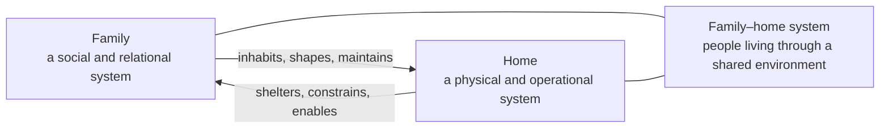
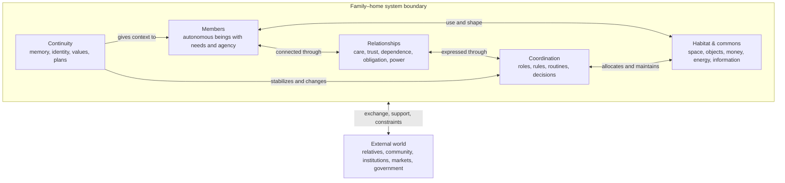
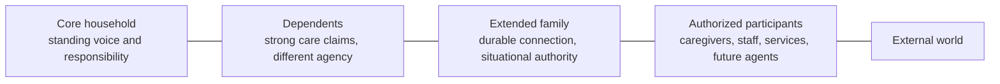
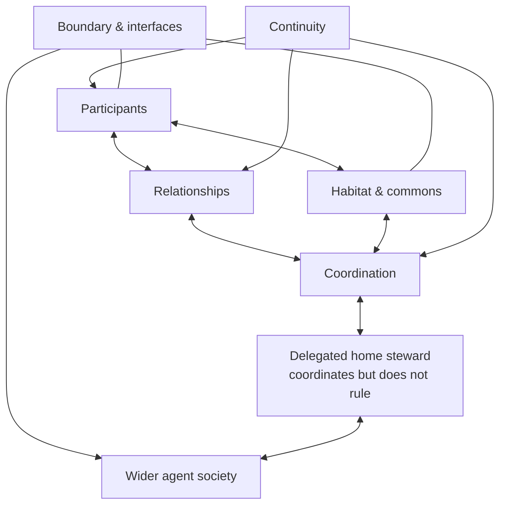
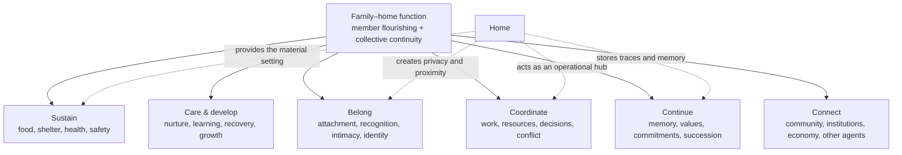
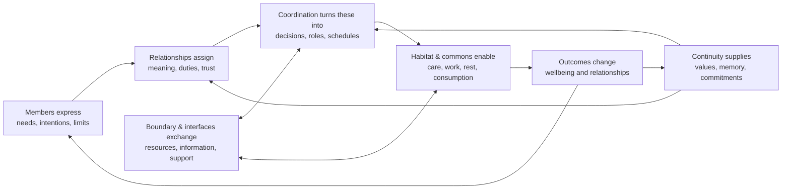
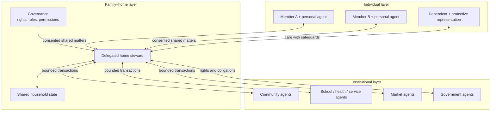

# Foundation session transcript

Dates: **2026-07-16 to 2026-07-17**

Codex task: **Define family agent model**

Task ID: `019f6b8c-16d1-7a91-8ce0-8cdd32eeccb5`

This archive contains the user and assistant messages exported from the Codex task through the repository-transfer request. Tool calls, tool outputs, hidden reasoning, and system instructions are intentionally excluded. Interactive choice results are recorded below because they were returned through controls rather than ordinary chat messages.

## Interactive decisions

1. Primary system boundary: **Family–home system**.
2. Membership model: **Layered membership**.
3. Normative stance: **Descriptive structure plus a separate health layer**.
4. Initial agent position: **Delegated steward**.
5. Ultimate beneficiary rule: **Dual mandate** balancing member flourishing and collective continuity.
6. Conflict guardrail: **Rights floor plus negotiation**.
7. Agent topology: **Federated layers**.
8. Steward initiative: **Risk-scaled autonomy**.
9. First stress test: **Ordinary weekday**.
10. Scenario household: **Fictional mixed household**.

---

## User

This is a project to build an agent for managing a home. This is an attempt to peek into the future of AI and how it will be integrated in society. I envision a future where intelligence diffuses into every level of society starting from individual level, institution/org level to the government. The diffusion that I envision looks like a graph where every node is an agent that can operate, communicate and collaborate with other agents. A home/family is a stable unit of every society and therefore it can be mapped into an agent. The final state of this project is not defined or known. It will be an exploration guided by the proposition that a coherent structure will emerge through trial and error. Your work is to help me explore

The first task is to define a family by its most basic components. After that we will define what the function of a family/home is then we will establish how the basic components interact to perform the function . Visuals such as diagrams and illustrations will be very beneficial in this project. Lets begin

Make this session interactive. I am also trying to figure out where this is going

---

## Assistant — commentary

I’ll start by grounding this in whatever already exists in the project, then use the visualization skill to turn the first conceptual model into something we can inspect and challenge together. I’ll treat “family” and “home” as related but distinct until we decide otherwise.

---

## Assistant — commentary

The workspace is a clean slate, which fits the exploratory nature of the project.

A useful first distinction is:

This matters because an agent that manages only the home becomes a sophisticated household operator; an agent that participates in the family system must also understand relationships, boundaries, care, authority, memory, and values. The latter is much more interesting—and much more delicate.

---

## Assistant — commentary

With that boundary choice, I’d use this as our first draft—not a final definition:

The crucial move here is that the family is not merely a list of people. It is a bounded, persistent pattern of relationships living through a shared world over time. The home is part habitat, part commons, and part coordination surface.

Before refining the components, we need to decide what makes someone “inside” this system.

---

## Assistant — commentary

Layered membership suggests concentric boundaries rather than a single in/out line:

These are not ranks of human worth. They describe different access, authority, responsibility, and care obligations. A person can occupy more than one role, and roles can change over time.

Our working definition is now:

> A family–home system is a persistent network of people and other dependents, connected through layered relationships and participation, that shares and governs a habitat and commons while carrying commitments, identity, and memory through time.

One philosophical choice remains before we can call the component model stable: whether it describes families as they actually are, or as they ought to be. This matters because conflict, neglect, unequal power, separation, and competing values are real system states—not exceptions an agent can safely ignore.

---

## Assistant — commentary

Good. That gives us two separate models:

- The structural model answers: “What exists, who is connected, and how is the household organized?”
- The health model later asks: “Is the system safe, caring, fair, autonomy-preserving, and able to recover from strain?”

That separation prevents the agent from confusing “the current arrangement” with “the arrangement that ought to be preserved.”

There is one last boundary decision that affects the definition itself: where the future AI belongs. In your graph vision, the family–home becomes an agent at the societal scale—but internally, the AI could be a tool, a delegated representative, or eventually something more member-like.

---

## Assistant — commentary

We now have a stable first checkpoint.

### Basic components of a family–home system

1. **Participants** — core members, dependents, extended family, and authorized participants.
2. **Relationships** — care, attachment, trust, obligation, authority, dependence, conflict, and reciprocity.
3. **Habitat and commons** — physical space plus shared objects, money, energy, food, information, and attention.
4. **Coordination** — roles, rules, routines, permissions, decisions, and conflict resolution.
5. **Continuity** — shared memory, identity, commitments, values, and future plans.
6. **Boundary and interfaces** — who belongs in what capacity, what may cross the boundary, and how the system relates to community, institutions, markets, government, and other agents.

The home agent is not a seventh basic component and not a family member. It is a delegated capability operating through **coordination** and **interfaces**. At the societal scale, it can represent the family–home node; internally, its authority remains derived from the people it serves.

The parallel health layer will later evaluate safety, autonomy, care, fairness, privacy, and resilience without pretending that every existing family already embodies them.

The next phase is function. The sharpest opening question is: *who or what is the family ultimately for?*

---

## Assistant — commentary

A dual mandate makes the family neither a disposable service arrangement nor an organism entitled to consume its members. Its provisional function becomes:

> **To sustain and develop its members while maintaining a viable, meaningful collective across time.**

That separates into six functions:

“Continue” does not require biological reproduction or keeping one household intact forever. A family can continue through care, memory, relationships, culture, adaptation, and chosen succession. Likewise, separation may sometimes preserve people better than forced continuity.

The dual mandate now needs a rule for hard conflicts. Otherwise a future agent could justify harm in the name of “family unity.”

---

## Assistant — commentary

We can now express the family–home as a living feedback loop rather than a static inventory:

The rights floor constrains the entire loop; negotiation happens inside that safe region. The delegated steward can observe selected signals, help form decisions, act within permission, and record outcomes—but it should not silently redefine relationships or values.

Your original graph vision creates a major architectural choice: whether intelligence is centralized in one household agent, or distributed across member-level and institution-level agents.

---

## Assistant — commentary

Federated layers preserve the graph at multiple scales:

This implies that “family knowledge” is not a single database. Some knowledge is private, some shared, some delegated for a purpose, and some externally exchanged. The family agent coordinates the shared layer without automatically owning every member’s inner life.

To finish the interaction model, we need to decide how action authority should scale.

---

## Assistant — commentary

Risk-scaled autonomy completes the first interaction contract:

1. **Observe only what has been permitted.**
2. **Interpret using shared context, without treating inference as fact.**
3. **Propose or negotiate when interests differ.**
4. **Act directly only when the action is permitted, low-risk, and reversible.**
5. **Escalate as consequences, irreversibility, uncertainty, or disagreement rise.**
6. **Record outcomes and update shared memory without absorbing private memory.**
7. **Never trade away the rights floor for efficiency or family continuity.**

We now have a coherent first model of components, function, interactions, and the agent’s place within them. The best way to keep this exploratory is to stress-test it against a concrete household episode; whatever the model fails to explain becomes our next refinement.

---

## Assistant — commentary

For the weekday test to expose real interactions, it needs a concrete household rather than anonymous boxes. We can use a fictional household first, or ground it in your own situation. No personal details are necessary unless you want the model to be immediately practical.

---

## Assistant — proposed plan

# Family–Home System: Foundational Model and First Experiment

## Summary

Define the family–home as a persistent, adaptive system with a dual mandate:

> Sustain and develop its members while preserving a viable, meaningful collective across time.

Family and home remain distinct but coupled. The family is relational; the home is its habitat and operational commons. A rights floor—safety, dignity, privacy, and basic autonomy—constrains all efforts to preserve the collective.

## Foundational Model

The system has six basic components:

1. **Participants** — core members, dependents, extended family, and authorized participants.
2. **Relationships** — care, trust, obligation, authority, dependence, reciprocity, and conflict.
3. **Habitat and commons** — space, possessions, money, food, energy, information, and shared attention.
4. **Coordination** — roles, rules, routines, permissions, decisions, and conflict resolution.
5. **Continuity** — memory, identity, values, commitments, and future plans.
6. **Boundary and interfaces** — membership levels and exchanges with communities, institutions, markets, government, and other agents.

Its functions are to sustain, care and develop, create belonging, coordinate shared life, preserve continuity, and connect members to wider society.

## Agent and Interaction Model

- Use a **federated graph**: personal agents retain individual authority and private context; the family agent manages shared matters; institutional agents communicate through bounded interfaces.
- Treat the home agent as a **delegated steward**, not a family member or sovereign decision-maker.
- Classify information as private, shared, purpose-delegated, or approved for external exchange.
- Use risk-scaled autonomy:
  - Automatically perform permitted, low-risk, reversible actions.
  - Request confirmation as uncertainty, consequence, disagreement, or irreversibility rises.
  - Escalate major decisions to the appropriate members.
  - Never cross the rights floor, even to improve efficiency or preserve family unity.
- Structure interactions as: observe → interpret → propose/negotiate → authorize → act → evaluate → update shared memory.

## First Stress Test: Ordinary Weekday

Model a fictional household containing two adults with different work schedules, one school-age child, a nearby elder with some care needs, and a pet.

Follow one weekday through:

- Morning preparation, breakfast, school, work, and transport.
- Competing schedules and use of shared spaces.
- Groceries, supplies, bills, and household maintenance.
- A change involving the elder’s care.
- The child’s return, homework, recreation, and privacy.
- Dinner, chores, rest, and preparation for the next day.

For every episode, record:

- Which components are involved.
- Whose needs and rights are affected.
- What information is private or shared.
- Who holds decision authority.
- What the steward may do automatically.
- What requires negotiation or escalation.
- How the outcome changes relationships, resources, and shared memory.

## Acceptance Criteria and Assumptions

- The model must explain routine cooperation, competing interests, dependencies, and unexpected changes without assuming a perfectly harmonious family.
- Collective continuity may require negotiated sacrifice but cannot override safety, dignity, privacy, or basic autonomy.
- Membership is layered and dynamic rather than determined solely by biology, law, or residence.
- The fictional household is an experimental instrument, not a claim that one household form is universal.
- Gaps exposed by the weekday test become the next revisions to the model.

---

## User

PLEASE IMPLEMENT THIS PLAN:
# Family–Home System: Foundational Model and First Experiment

## Summary

Define the family–home as a persistent, adaptive system with a dual mandate:

> Sustain and develop its members while preserving a viable, meaningful collective across time.

Family and home remain distinct but coupled. The family is relational; the home is its habitat and operational commons. A rights floor—safety, dignity, privacy, and basic autonomy—constrains all efforts to preserve the collective.

## Foundational Model

The system has six basic components:

1. **Participants** — core members, dependents, extended family, and authorized participants.
2. **Relationships** — care, trust, obligation, authority, dependence, reciprocity, and conflict.
3. **Habitat and commons** — space, possessions, money, food, energy, information, and shared attention.
4. **Coordination** — roles, rules, routines, permissions, decisions, and conflict resolution.
5. **Continuity** — memory, identity, values, commitments, and future plans.
6. **Boundary and interfaces** — membership levels and exchanges with communities, institutions, markets, government, and other agents.

Its functions are to sustain, care and develop, create belonging, coordinate shared life, preserve continuity, and connect members to wider society.

## Agent and Interaction Model

- Use a **federated graph**: personal agents retain individual authority and private context; the family agent manages shared matters; institutional agents communicate through bounded interfaces.
- Treat the home agent as a **delegated steward**, not a family member or sovereign decision-maker.
- Classify information as private, shared, purpose-delegated, or approved for external exchange.
- Use risk-scaled autonomy:
  - Automatically perform permitted, low-risk, reversible actions.
  - Request confirmation as uncertainty, consequence, disagreement, or irreversibility rises.
  - Escalate major decisions to the appropriate members.
  - Never cross the rights floor, even to improve efficiency or preserve family unity.
- Structure interactions as: observe → interpret → propose/negotiate → authorize → act → evaluate → update shared memory.

## First Stress Test: Ordinary Weekday

Model a fictional household containing two adults with different work schedules, one school-age child, a nearby elder with some care needs, and a pet.

Follow one weekday through:

- Morning preparation, breakfast, school, work, and transport.
- Competing schedules and use of shared spaces.
- Groceries, supplies, bills, and household maintenance.
- A change involving the elder’s care.
- The child’s return, homework, recreation, and privacy.
- Dinner, chores, rest, and preparation for the next day.

For every episode, record:

- Which components are involved.
- Whose needs and rights are affected.
- What information is private or shared.
- Who holds decision authority.
- What the steward may do automatically.
- What requires negotiation or escalation.
- How the outcome changes relationships, resources, and shared memory.

## Acceptance Criteria and Assumptions

- The model must explain routine cooperation, competing interests, dependencies, and unexpected changes without assuming a perfectly harmonious family.
- Collective continuity may require negotiated sacrifice but cannot override safety, dignity, privacy, or basic autonomy.
- Membership is layered and dynamic rather than determined solely by biology, law, or residence.
- The fictional household is an experimental instrument, not a claim that one household form is universal.
- Gaps exposed by the weekday test become the next revisions to the model.

---

## Assistant — commentary

I’ll turn the conceptual plan into a documentation-first project: a formal model, a fully traced weekday experiment, machine-readable data for future agent code, and diagrams that make the system inspectable. I’m using the visualization skill because the component and interaction relationships are much easier to evaluate graphically than as prose alone.

---

## Assistant — commentary

The conceptual model and weekday trace are now encoded. I’ve made authority, information boundaries, steward limits, outcomes, and unresolved questions explicit for all ten episodes; I’m validating the data and its invariants next.

---

## Assistant — commentary

Validation is clean: the reference experiment exercises all six components, all four information classes, five autonomy modes, and all four required household dynamics. The negative tests also confirm that unknown participants, missing rights checks, unexercised coverage, and steward access to private information are rejected.

---

## Assistant — final

Implemented the foundational project and first experiment.

- [README.md](C:/Users/peter/OneDrive/Documents/homie/README.md) introduces the vision and workflow.
- [Foundational model](C:/Users/peter/OneDrive/Documents/homie/docs/foundational-model.md) defines components, functions, rights floor, federated agents, and risk-scaled autonomy with Mermaid diagrams.
- [Ordinary weekday experiment](C:/Users/peter/OneDrive/Documents/homie/experiments/ordinary-weekday.md) traces ten household episodes and documents findings and model gaps.
- [Machine-readable experiment](C:/Users/peter/OneDrive/Documents/homie/experiments/ordinary-weekday.json) and [JSON Schema](C:/Users/peter/OneDrive/Documents/homie/schemas/family-home.schema.json) establish the first formal domain representation.
- [Validator](C:/Users/peter/OneDrive/Documents/homie/scripts/validate_model.py) enforces references, rights checks, privacy boundaries, and experiment coverage.

Verification passed:

- 10 episodes validated.
- All six components and four information classes exercised.
- Five autonomy modes covered.
- 5 regression tests passed.
- Local links and whitespace checks passed.

The experiment exposed eight concrete areas for future exploration, especially delegation lifecycles, shared-memory governance, coercion, evolving dependent autonomy, and overlapping households. All files are currently uncommitted.

---

## User

A major problem that I would like to explore is the form homie would take. How would users interact with it? Remember homie has to be an organic and attractive companion. It has to be offered in a form that users can connect to - Like how chatgpt was offered as a chat interface

---

## Assistant — commentary

I’m using the visualization skill because “what form does Homie take?” is really a question about how its presence changes across private, shared, routine, and urgent moments. I’ll map those interaction modes first, then propose a coherent companion form rather than treating it as merely another chat app.

---

## Assistant — final

The key insight is this:

> ChatGPT was offered as a conversation with an intelligence. Homie should be offered as a relationship with a household presence.

Its form should therefore not be one device, screen, or robot. It should be one recognizable character expressed through several interaction surfaces.

### The central form: the Hearth

I think Homie’s iconic interface should be a persistent shared space called the **Hearth**.

Unlike a normal chat, it opens onto the household’s present life:

- What is happening now?
- What needs attention?
- Who is affected?
- Is Homie observing, suggesting, waiting for permission, or acting?
- What will be remembered?

Conversation remains the universal input, but messages belong to ongoing household episodes—school transport, dinner, elder care, repairs, celebrations—rather than an undifferentiated chat history.

### One identity, five manifestations

::codex-inline-vis{file="homie-presence-modes.html"}

- **Whisper:** each person’s private relationship with Homie.
- **Hearth:** the shared family space for decisions, plans, stories, and rituals.
- **Home:** quiet ambient actions and cues within existing permission.
- **Signal:** an unmistakable posture for urgent interruptions.
- **Door:** the interface through which Homie deals with services and external agents.

The audience must always be visible. A user should never wonder whether they are speaking privately, speaking to the household, or authorizing external action.

### What would make it feel organic

Homie’s character should come primarily from behavior:

- It has a stable voice and recognizable visual presence.
- It understands relationships without pretending to be a family member.
- It knows when silence is more caring than interruption.
- It remembers commitments and rituals, but lets people inspect, correct, and forget memories.
- It admits uncertainty and repairs mistakes.
- It develops household-specific rhythms without constructing hidden personality profiles.
- It can be warm, playful, and celebratory—not merely efficient.

A mascot or physical body could strengthen this later, but personality cannot compensate for poor social judgment.

### My bet for the first product form

Start with a phone/web experience containing:

1. A private Whisper for every member.
2. One shared Hearth for the household.
3. A “Now” view showing the few active household episodes.
4. Clear action states such as *noticed*, *suggesting*, *waiting for Maya*, and *completed*.
5. Morning and evening rituals that gradually establish Homie’s presence.
6. Voice as an optional interaction method, not an always-listening requirement.

Later, the Hearth could gain a physical home presence: a small communal object or display with voice, light, and restrained movement. I would avoid beginning with a humanoid robot or smart-speaker form; both carry assumptions that could distort the relationship before Homie’s social behavior is understood.

Picture the first thirty seconds after you return home exhausted: what would Homie do that makes it feel like a companion rather than software?

---

## User

Create a repo and push the enterety of this project. Iclude this chat. I will proceed from a different device

---

## Assistant — commentary

I’ll package the complete workspace, add a durable session record for continuity, create a GitHub repository, commit everything, and push it. I’ll first check the current Git/GitHub state and whether the Codex task can be exported directly so the chat record is accurate.

---

## Assistant — commentary

The workspace is ready, but GitHub authentication has expired for account `Peternyaga`. I can still prepare the complete commit and chat record now; repository creation and push will require re-authentication or approval of the GitHub plugin installation.

---

## User

I have gh istalled. i will refresh the token

---

## Assistant — commentary

Great—please refresh `gh` for `Peternyaga`; I’ll prepare the complete commit and session handoff while you do that. Once authentication is valid, I’ll create the remote repository and push immediately.
