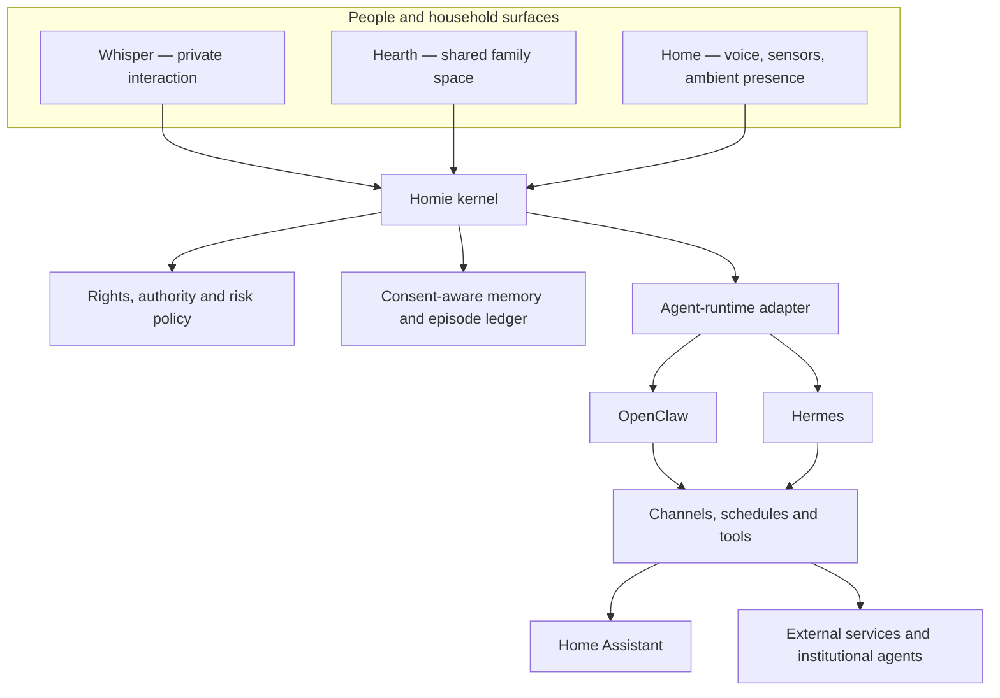

# Existing-agent infrastructure session

Date: **2026-07-18**

Codex task: **Define family agent model**

Task ID: `019f6b8c-16d1-7a91-8ce0-8cdd32eeccb5`

This archive contains the substantive user and assistant messages from the exploration of OpenClaw and Hermes. Tool calls, tool outputs, hidden reasoning, and system instructions are intentionally excluded.

---

## User

There are already existing personal agents like open claw and Hermes - I have not used them yet but I'm thinking about how/whether such agentic infrastructures can be adopted for homie. Lets explore what can be done using the already existing tools

---

## Assistant

Yes—much of Homie's machinery can be assembled from existing agents. But Homie should not simply become an OpenClaw or Hermes configuration.

The durable product should be a **household governance layer** that can use either runtime underneath it:

The distinction is:

- **OpenClaw or Hermes:** How does the agent communicate, reason, schedule work and call tools?
- **Homie:** Who may know something, who may decide, what may happen automatically, and what belongs to the household's shared memory?

### What can be reused

| Capability | OpenClaw | Hermes |
| --- | --- | --- |
| Messaging | Strong multi-channel gateway | Strong multi-platform gateway |
| Multiple agents | Explicit agents, workspaces and routing | Independent profiles and per-user sessions |
| Tool execution | Plugins, hooks, sandbox and tool policies | Built-in tools, MCP, approval modes and containers |
| Companion personality | Memory and inferred commitments | `SOUL.md`, intentional silence and learning loop |
| Smart home | Extensible through tools/plugins | Direct Home Assistant integration |
| Household governance | Must be added | Must be added |

OpenClaw is particularly close to Homie's **federated-agent topology**. It supports isolated agent workspaces, explicit routing, per-agent tool restrictions and even documents a sandboxed "family agent" connected to a WhatsApp group. Its hooks could run Homie's policy check before any tool call. [OpenClaw multi-agent routing](https://docs.openclaw.ai/concepts/multi-agent), [plugin hooks](https://docs.openclaw.ai/plugins/hooks)

But OpenClaw explicitly warns that one gateway normally assumes **one trusted operator**. Several family members sharing a tool-enabled gateway do not automatically become securely isolated principals. A serious Homie deployment would therefore need separate personal-agent boundaries—possibly separate gateways, OS users or containers—not merely separate chat sessions. [OpenClaw security model](https://docs.openclaw.ai/gateway/security)

Hermes is especially interesting for making Homie feel **organic**:

- `SOUL.md` provides a durable identity and voice. [Hermes personality](https://hermes-agent.nousresearch.com/docs/user-guide/features/personality)
- It can remain intentionally silent while still observing the conversational context. [Hermes messaging](https://hermes-agent.nousresearch.com/docs/user-guide/messaging)
- Memory and skill changes can require approval. [Hermes memory](https://hermes-agent.nousresearch.com/docs/user-guide/features/memory/)
- Separate profiles can represent independent personal or household agents. [Hermes profiles](https://hermes-agent.nousresearch.com/docs/user-guide/profiles/)
- Its Home Assistant integration can receive selected household events and operate smart-home tools. [Hermes Home Assistant integration](https://hermes-agent.nousresearch.com/docs/user-guide/messaging/homeassistant)

Hermes's learning loop is attractive, but for Homie it must become **consent-governed learning**. A family agent should not silently turn one person's private disclosure into household memory or a permanent behavioral rule.

### What Homie must add

Neither platform appears to provide the family-specific primitives we need:

1. **Household identity registry:** member, dependent, caregiver, guest and external-agent relationships.
2. **Information envelopes:** every fact classified as private, shared, purpose-delegated or externally approved.
3. **Delegated authority:** permission containing scope, owner, expiry, revocation and spending/action limits.
4. **Rights-and-risk preflight:** a deterministic check before the language model can perform consequential actions.
5. **Episode ledger:** a record of what happened, what was proposed, who authorized it and what was learned.
6. **Memory promotion:** moving information into durable memory only when its audience, source and consent are clear.
7. **Household interaction grammar:** Whisper, Hearth, Home, Signal and Door should remain stable even if the runtime changes.

Prompts alone are insufficient for these controls. They need to be enforced in code around tool calls and memory writes.

### Recommended first experiment

Start with OpenClaw as the first **coordination substrate**, then repeat the experiment with Hermes to study companionship and ambient-home behavior.

Use the existing ordinary-weekday household and introduce one disruption:

> The elder's appointment changes while both adults have work commitments and the child needs collecting from school.

The prototype should:

1. Receive private messages from the affected people.
2. Reveal only the minimum necessary information in the family space.
3. Construct several workable plans.
4. Identify who has authority to approve each commitment.
5. Request confirmation before changing transport or care arrangements.
6. Call only simulated tools—no real bookings or payments.
7. Record the final episode without copying private conversations into shared memory.

OpenClaw can test routing, isolation and authorization hooks. Hermes can then test whether the same episode feels warmer and more natural through personality, intentional silence, approved learning and an ambient Home Assistant surface.

Combining both full runtimes initially would duplicate routing, memory, and authority and make failures difficult to understand. Homie should compare them through the same adapter contract first.

The most revealing next question is: **what would make this weekday-disruption demo feel genuinely like Homie, rather than a capable bot sitting in a family group chat?**
